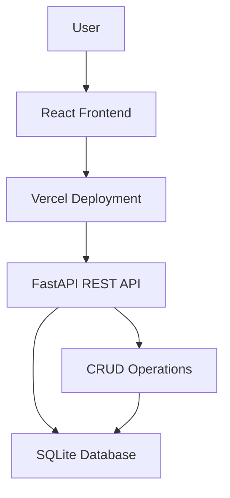

# AccessAudit – Accessibility Audit Platform

AccessAudit is a responsive web application designed to help users identify, manage, and track website accessibility issues. It provides a centralized dashboard for recording findings, monitoring their status, and managing accessibility improvements.

## Live Application

**Frontend:** https://accessibility-architecture-audit.vercel.app

**Backend API:** https://accessibility-architecture-audit.onrender.com

**API Documentation:** https://accessibility-architecture-audit.onrender.com/docs

## Features

- **Simulated Authentication:** Demo login and logout functionality.
- **Dashboard:** Overview of total, open, in-progress, and resolved findings.
- **Create Findings:** Add accessibility issues with relevant details.
- **Read Findings:** View all recorded accessibility findings.
- **Update Findings:** Change the status of existing findings.
- **Delete Findings:** Remove findings when they are no longer required.
- **Search and Filtering:** Search findings and filter by status or severity.
- **Sorting:** Organize findings for easier management.
- **Persistent State:** Backend database storage with browser localStorage caching.
- **Responsive Design:** Mobile-first interface that adapts to different screen sizes.
- **Accessible Interface:** Semantic HTML, labeled form controls, and keyboard-friendly interactions.

## Technology Stack

| Layer | Technologies |
|---|---|
| Frontend | React.js, Vite, JavaScript |
| Styling | CSS3, CSS Custom Properties |
| Backend | Python, FastAPI |
| Database | SQLite |
| API | REST API, JSON |
| Frontend Deployment | Vercel |
| Backend Deployment | Render |
| Version Control | Git, GitHub |

## Architecture



## Demo Login Credentials

Use the following credentials to access the application:

- **Email:** admin@accessaudit.com
- **Password:** admin123

**Note:** Authentication is simulated for demonstration purposes. It is not intended for production security.

## Local Installation and Setup

### Prerequisites

- Node.js and npm
- Python 3.10 or later
- Git

### 1. Clone the Repository

```powershell
git clone https://github.com/samikshasathis24-hub/accessibility-architecture-audit.git

cd accessibility-architecture-audit
```

### 2. Set Up the Backend

Open a terminal:

```powershell
cd server

py -m venv venv

.\venv\Scripts\Activate.ps1

pip install -r requirements.txt

uvicorn app.main:app --reload
```

Backend runs locally on port `8000`.

### 3. Set Up the Frontend

Open a second terminal:

```powershell
cd client

npm install
```

Create a `.env` file inside the `client` folder:

```env
VITE_API_URL=http://127.0.0.1:8000
```

Start the frontend:

```powershell
npm run dev
```

Open the local development address displayed in the terminal.

## API Endpoints

| Method | Endpoint | Description |
|---|---|---|
| GET | `/health` | Check backend health |
| GET | `/findings` | Retrieve all findings |
| POST | `/findings` | Create a new finding |
| PUT | `/findings/{id}` | Update a finding |
| DELETE | `/findings/{id}` | Delete a finding |

## Deployment

The application is deployed using separate frontend and backend services.

**Frontend – Vercel**
- Root directory: `client`
- Framework: Vite
- Environment variable: `VITE_API_URL`

**Backend – Render**
- Root directory: `server`
- Build command: `pip install -r requirements.txt`
- Start command: `uvicorn app.main:app --host 0.0.0.0 --port $PORT`

The backend uses the `CORS_ORIGINS` environment variable to allow frontend communication.

## Project Structure

```text
accessibility-architecture-audit/
│
├── client/
│   ├── src/
│   │   ├── components/
│   │   ├── pages/
│   │   │   └── Login.jsx
│   │   ├── api.js
│   │   ├── App.jsx
│   │   └── App.css
│   ├── .env.example
│   └── package.json
│
├── server/
│   ├── app/
│   │   └── main.py
│   └── requirements.txt
│
├── docs/
├── tests/
└── README.md
```

## Important Note

The deployed application uses SQLite on the Render free service. Since its filesystem is not persistent by default, database records may be lost when the service restarts or is redeployed. A persistent database can be configured in a future enhancement.

## Future Enhancements

- Secure authentication and role-based access.
- Persistent cloud database integration.
- Accessibility report generation.
- Advanced analytics and reporting.
- Automated accessibility testing integration.

## Conclusion

AccessAudit demonstrates the development and deployment of a full-stack web application using React, FastAPI, and SQLite. It brings together responsive frontend development, RESTful API integration, CRUD functionality, and cloud deployment in one project.